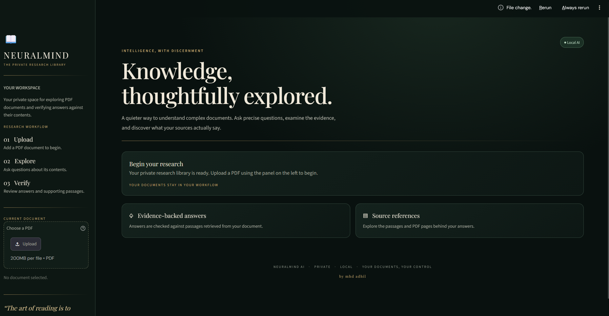
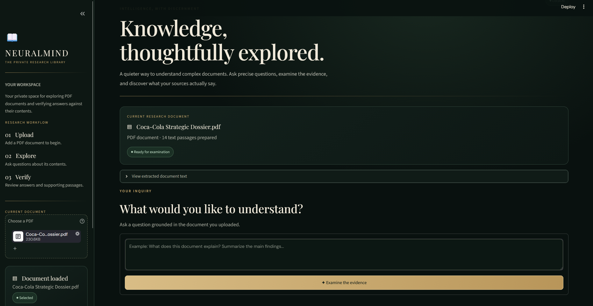
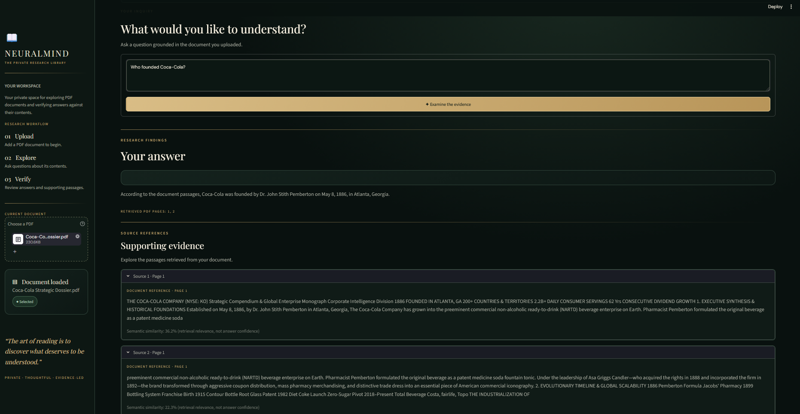
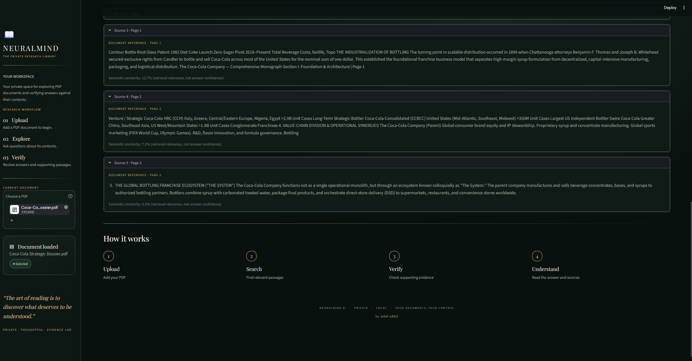
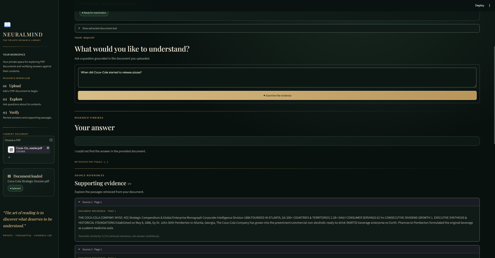
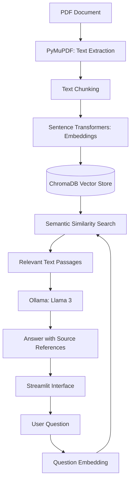

# 🧠 NeuralMind AI — Document Research Assistant

A local AI-powered document research assistant that allows users to ask questions about PDF documents and receive answers grounded in the document's content.

NeuralMind AI combines semantic search, vector embeddings, and a locally running large language model to retrieve relevant information and generate context-aware responses.

## ✨ Features

- **PDF Text Extraction:** Extract text from PDF documents using PyMuPDF.
- **Text Chunking:** Split extracted text into smaller, manageable sections for retrieval.
- **Semantic Search:** Find relevant passages based on meaning rather than exact keyword matches.
- **Vector Embeddings:** Represent text as numerical vectors using Sentence Transformers.
- **Vector Database:** Store and retrieve document embeddings using ChromaDB.
- **Local AI Responses:** Generate answers using Ollama and a locally running language model.
- **Source-Grounded Answers:** Use retrieved document passages to support generated responses.
- **Page References:** Help users trace answers back to the relevant PDF pages.
- **Unsupported Question Handling:** Avoid generating unsupported answers when the document does not contain sufficient information.
- **Automated Tests:** Test important components of the document research pipeline.

## 🛠️ Technology Stack

| Technology | Purpose |
|---|---|
| Python | Application logic |
| Streamlit | Interactive web interface |
| PyMuPDF | PDF text extraction |
| Sentence Transformers | Text embeddings |
| all-MiniLM-L6-v2 | Embedding model |
| ChromaDB | Vector storage and similarity search |
| Ollama | Local language model execution |
| Pytest | Automated testing |

## 📸 Application Screenshots

### Home Interface



### PDF Upload



### Asking Questions



### AI-Generated Answer



### Retrieved Sources



## 🧩 System Architecture



## 🏗️ How It Works

1. **Load a PDF:** The application reads the document and extracts its text.
2. **Split the text:** The extracted text is divided into smaller chunks.
3. **Generate embeddings:** Each chunk is converted into a numerical representation.
4. **Store the vectors:** The embeddings are stored in ChromaDB.
5. **Search the document:** A user's question is converted into an embedding and compared with the stored document vectors.
6. **Generate an answer:** Relevant passages are supplied to the local language model.
7. **Return the response:** The application displays an answer based on the retrieved content, with source references where available.

## ⚙️ Prerequisites

Before running NeuralMind AI, install:

- Python 3.10 or a compatible version supported by the dependencies.
- Git.
- Ollama.
- The Ollama model `llama3:latest`.

## 🚀 Installation and Setup

### 1. Clone the repository

```bash
git clone https://github.com/MhdAdhil7/NeuralMind-AI.git
cd NeuralMind-AI
```

### 2. Create a virtual environment

**Windows (PowerShell):**

```powershell
python -m venv .venv
.venv\Scripts\Activate.ps1
```

**macOS / Linux:**

```bash
python3 -m venv .venv
source .venv/bin/activate
```

If PowerShell blocks activation because of its execution policy, use this temporary setting for the current PowerShell session:

```powershell
Set-ExecutionPolicy -Scope Process -ExecutionPolicy RemoteSigned
```

Then activate the environment again.

### 3. Install dependencies

```bash
python -m pip install --upgrade pip
pip install -r requirements.txt
```

### 4. Download the Ollama model

Make sure Ollama is installed and running, then execute:

```bash
ollama pull llama3:latest
```

### 5. Run NeuralMind AI

From the project directory, execute:

```bash
streamlit run app.py
```

The application should open in your browser.

## 🧪 Running Tests

Pytest is used for automated testing. Install it separately if it is not already available:

```bash
pip install pytest
```

Run the test suite:

```bash
python -m pytest -v
```

## ⚠️ Troubleshooting

- **Ollama connection error:** Ensure Ollama is installed and running.
- **Model not found:** Run `ollama pull llama3:latest`.
- **Dependency errors:** Activate the virtual environment and reinstall the dependencies.
- **PDF extraction issues:** Ensure the PDF contains extractable text. Scanned image-only PDFs may require OCR.

## 🔒 Privacy and Processing

NeuralMind AI uses local PDF processing, local vector storage, and Ollama for local language-model inference. The application also imports external Google Fonts for interface styling.

Uploaded documents are processed by the application and stored in its local vector database. The privacy of stored documents depends on the security of the machine and its local storage. Avoid uploading sensitive documents unless you understand the system's storage and security configuration.

## 📌 Project Status

NeuralMind AI is a completed portfolio project demonstrating a document-based retrieval-augmented generation (RAG) workflow using Python, semantic search, vector storage, and a locally running language model.

The project is intended for learning and demonstration purposes, not as a production-grade document management or security system.